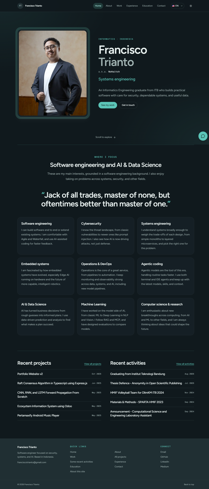
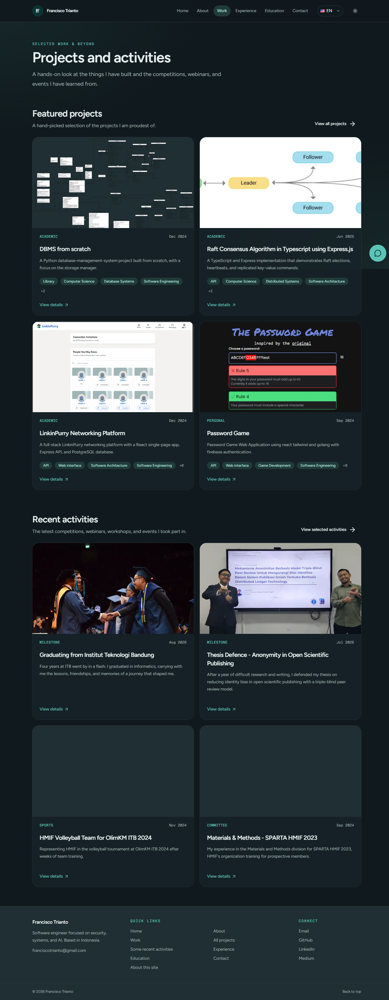
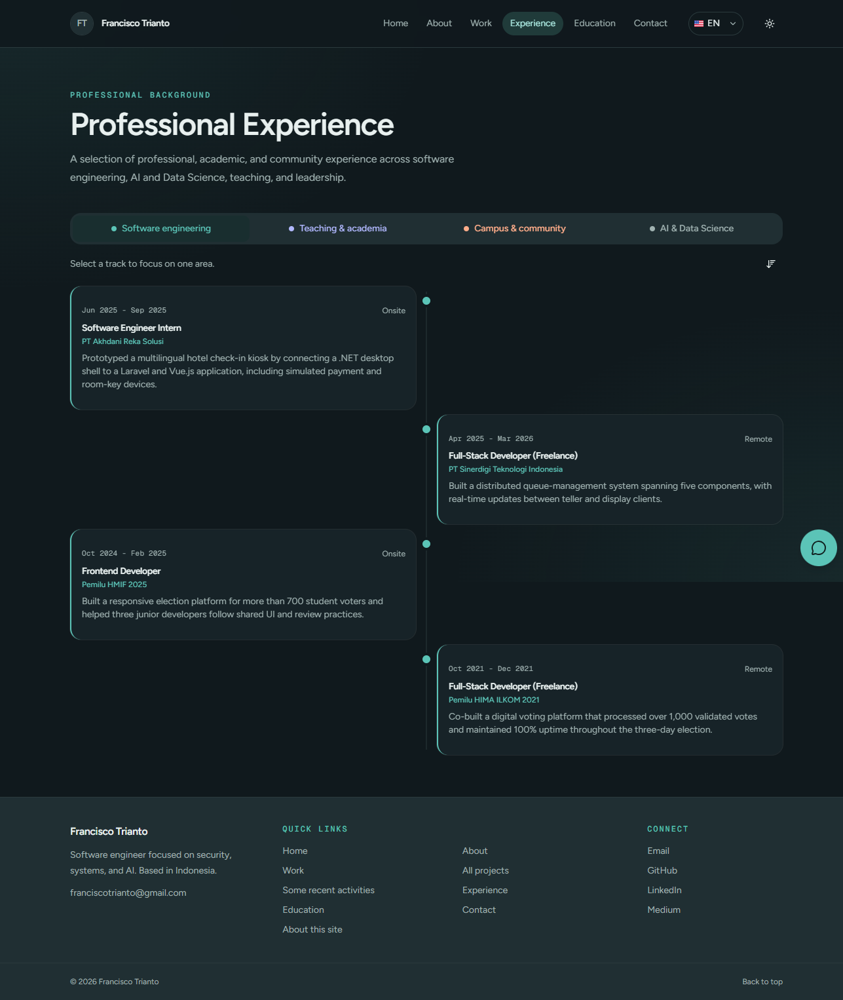
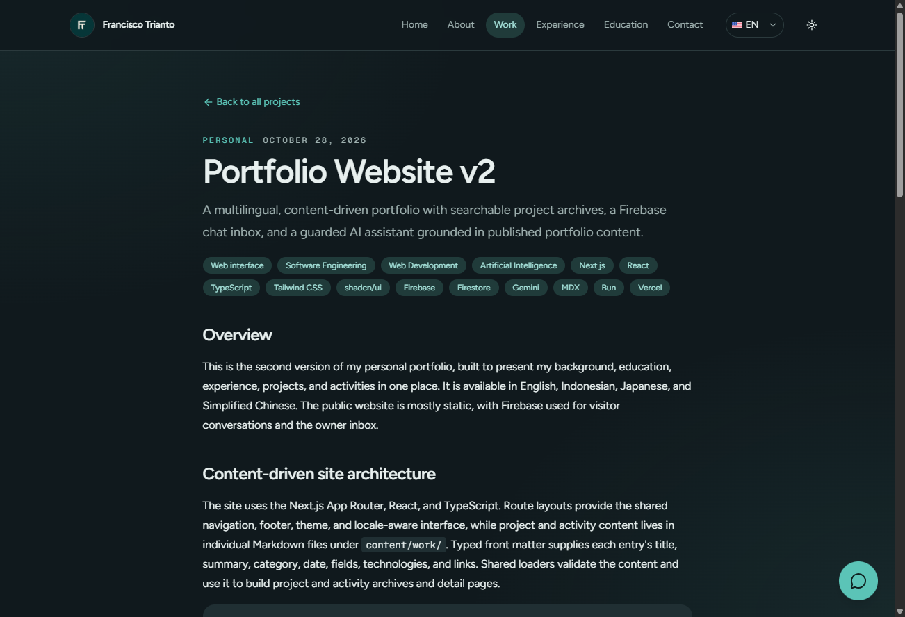
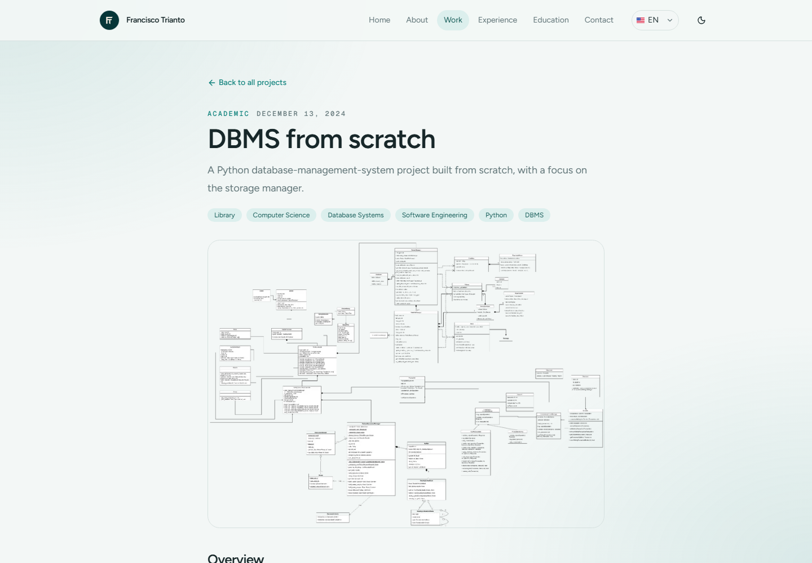
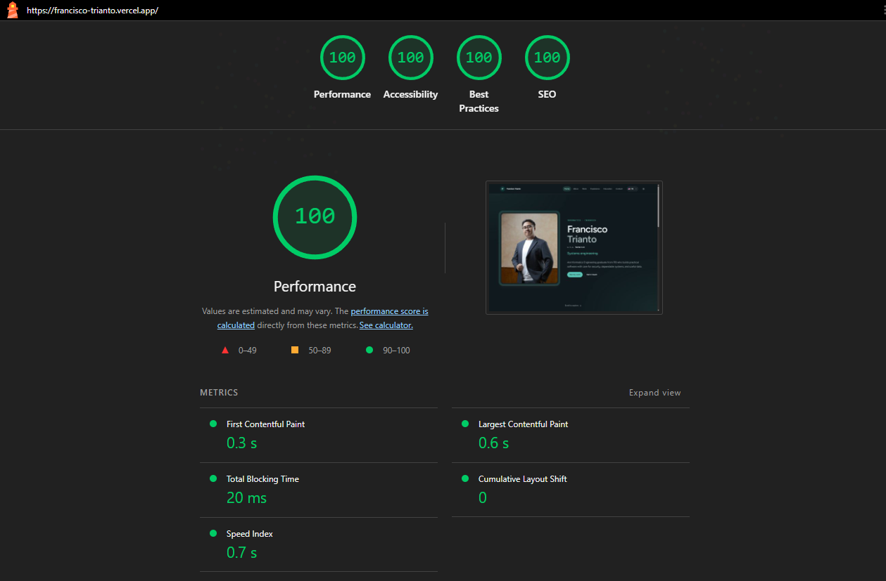

# Francisco Trianto portfolio

Personal portfolio for Francisco Trianto (NoHaitch), presenting his professional background, software engineering work, education, projects, activities, and ways to get in touch.

The site is static-first, accessible, and available in English, Indonesian, Japanese, and Simplified Chinese.
Its public pages are built around curated Markdown content and localized interface copy, with Firebase supporting the chat inbox and AI assistant.

## Screenshots

| Homepage                                               | Work                                      |
| ------------------------------------------------------ | ----------------------------------------- |
|  |  |

| Experience page                                       | Portfolio Website v2 project page                                         |
| ----------------------------------------------------- | ------------------------------------------------------------------------- |
|  |  |

| DBMS project detail                                           | Lighthouse report                                                            |
| ------------------------------------------------------------- | ---------------------------------------------------------------------------- |
|  |  |

## Pages

| Route                                | Purpose                                                           |
| ------------------------------------ | ----------------------------------------------------------------- |
| `/`                                  | Hero, areas of expertise, and five recent projects and activities |
| `/about`                             | Personal story, names, interests, hobbies, and photos             |
| `/work`                              | Recent projects and activities, with links to full lists          |
| `/work/projects`, `/work/activities` | Searchable, filterable, sortable lists with pagination            |
| `/experience`                        | Sortable timeline of engineering, teaching, and campus roles      |
| `/education`                         | Education timeline with coursework, honors, and certificates      |
| `/contact`                           | Professional and community links                                  |
| `/about-site`                        | What the site is for, how it is built, and the source code link   |
| `/admin/login`                       | Unlisted, noindex owner sign-in                                   |
| `/admin`, `/admin/messages`          | Owner dashboard and conversation inbox                            |
| `/admin/ai-test`                     | Owner-checked Gemini chat playground                              |

English uses unprefixed URLs.
Other languages use the `/id`, `/ja`, and `/zh` prefixes.

The homepage shows the five most recent projects and five most recent activities in side-by-side lists below the expertise section.
The activities collection is a curated selection, not a complete record of every activity.
Project and activity archives display eight entries per page and support search, category filters, and oldest-first or newest-first date sorting.
The archive state is stored in the URL, and both archive pages are available from the footer quick links.

The public chat widget uses anonymous Firebase Authentication and Firestore to keep a conversation visible to both the visitor and Francisco's admin inbox.
A server-side Gemini assistant answers questions about Francisco using approved portfolio content, while visitors can also ask Francisco directly.
AI answers are identified, may be inaccurate, and include compact source references when available.
Unanswered questions and service failures are flagged for human follow-up, and Francisco can reply in the same conversation.
The separate owner-only AI playground tests the same retrieval and guardrail pipeline.

## Stack

- Next.js 16 App Router, React 19, and TypeScript.
- Tailwind CSS 4 with shadcn-compatible components built on Base UI.
- `next/font` (Figtree and Geist Mono) and `next/image`.
- Bun for scripts and dependencies, Prettier for formatting, and ESLint for linting.

## Getting started

Install dependencies and start the development server:

```bash
bun install
bun run dev
```

Open [http://localhost:3000](http://localhost:3000).

Firebase client configuration is read from `NEXT_PUBLIC_FIREBASE_*` environment variables.
Copy `.env.example` to `.env.local` and fill in the Firebase Web app values before using Firebase features.
Environment files are git-ignored.
Add the same variables to the Vercel project environment for production builds.
These Firebase Web app values are public client configuration, not admin credentials.
Set `NEXT_PUBLIC_FIREBASE_ADMIN_EMAIL` to the Google account allowed by the unlisted admin sign-in page.
Set `NEXT_PUBLIC_FIREBASE_ADMIN_UID` to that Firebase Authentication account's UID.
Both values are public client configuration, not authorization secrets.
Before using chat, enable anonymous authentication and deploy the restrictive Firestore rules as described in [docs/chat.md](./docs/chat.md).
The Firestore rules, not the admin UI check, protect conversations.
For public chat AI and AI testing, configure the server-side Gemini API key and Firestore server credentials as described in [docs/ai-assistant.md](./docs/ai-assistant.md).
The admin AI page is an owner-only chat playground for trying the current Gemini model.
Its chat history is temporary.
It retrieves relevant portfolio content and applies input, context, and output checks on the server.
The playground allows 10 requests per owner per rolling hour.
Public chat additionally allows five AI requests per anonymous visitor and 30 requests in total per rolling hour, using Firestore transactions.
These model-based checks are not foolproof, and any previously enabled direct Firebase AI Logic access must be restricted separately.
These limits do not prevent visitors from creating new anonymous identities, exhausting the shared cap, or calling other enabled AI services directly.
Publish the updated Firestore rules before deploying the public assistant, and configure provider quotas and budget alerts.

## Scripts

| Command                | Description                                               |
| ---------------------- | --------------------------------------------------------- |
| `bun run dev`          | Start the development server                              |
| `bun run build`        | Build for production and type check                       |
| `bun run start`        | Serve the production build                                |
| `bun run format`       | Format the project with Prettier                          |
| `bun run format:check` | Check formatting                                          |
| `bun run lint`         | Run ESLint                                                |
| `bun run typecheck`    | Type check with `tsc --noEmit`                            |
| `bun run test`         | Run the Vitest unit tests                                 |
| `bun run test:e2e`     | Run the Playwright end-to-end tests                       |
| `bun run test:audit`   | Run the Lighthouse audit                                  |
| `bun run test:all`     | Typecheck, format check, unit tests, and end-to-end tests |

See [docs/testing.md](./docs/testing.md) for setup and what the tests cover.
The ESLint command currently fails to load because of an ESLint 10 and React plugin incompatibility.

## Project structure

- `app/[locale]/` holds the localized routes and shared layout.
- `components/layout/` holds the header and footer, and `components/ui/` holds shadcn primitives.
- `lib/i18n/` holds locale helpers, message types, and the dictionaries in `messages/`.
- `proxy.ts` rewrites unprefixed URLs to the internal English routes.
- `public/` holds static assets such as the portrait, education logos, and documents.
- `content/work/` holds one Markdown file per project or activity, with item media stored under `public/work/`.
- `content/assistant/` holds the manually curated assistant profile, approved education knowledge, and authoring guidance; it is part of the shared retrieval corpus.
- `lib/assistant/` loads the approved knowledge corpus, splits it into passages, retrieves relevant passages, and formats the grounded prompt.
- `components/admin/` contains the owner dashboard, chat inbox, fixed navigation rail, and private AI playground.
- `lib/firebase/` and `lib/chat/` contain Firebase clients and support-chat helpers.

## Documentation

- [docs/site-overview.md](./docs/site-overview.md) describes the current routes, structure, localization, and content.
- [docs/adding-content.md](./docs/adding-content.md) explains how to add a project or activity.
- [docs/content-structure.md](./docs/content-structure.md) explains how to structure the body of a project or activity article.
- [docs/design-system.md](./docs/design-system.md) is the visual style guide.
- [docs/testing.md](./docs/testing.md) explains the unit and end-to-end tests.
- [content/assistant/profile.md](./content/assistant/profile.md) holds personal context, tone, and public profiles for the assistant and portfolio writing.
- [content/assistant/education.md](./content/assistant/education.md) contains approved education, training, and transcript details for the assistant.
- [content/assistant/README.md](./content/assistant/README.md) explains how to maintain the assistant's approved knowledge source.
- [docs/chat.md](./docs/chat.md) explains Firebase setup, conversation access, and operational limitations.
- [docs/ai-assistant.md](./docs/ai-assistant.md) explains the AI assistant architecture, retrieval, model setup, and testing.

## Adding a route

1. Create the page under `app/[locale]/`.
2. Add its copy to `lib/i18n/types.ts` and all four dictionaries.
3. Link it from the header or footer, and update the docs.
